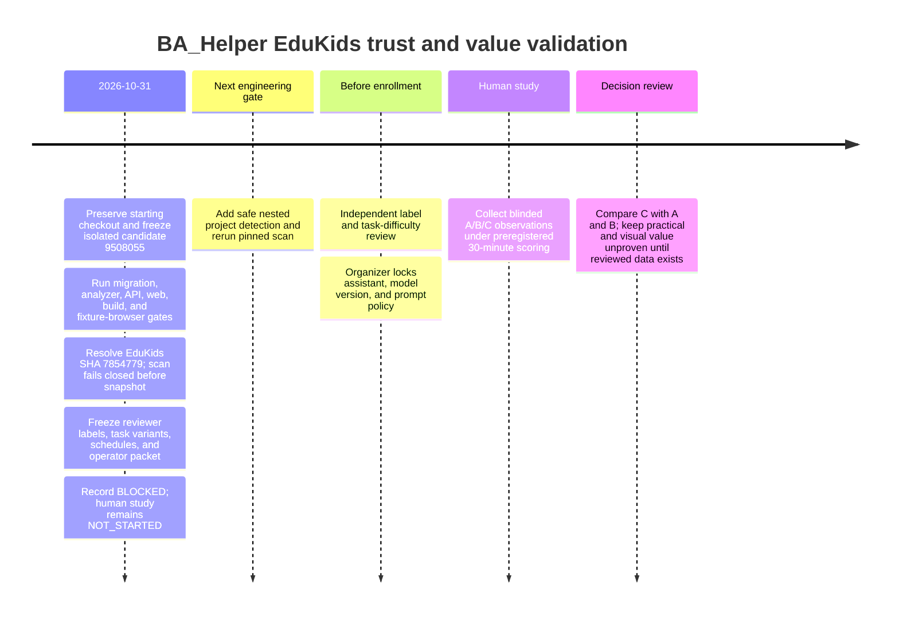

# EduKids real-world trust and value validation

**Decision: BLOCKED.** Engineering preparation is **not ready for human study**. Practical value and the incremental value of Visual Test Trace remain **unproven**.

## Pinned sources and candidate

- BA_Helper base: `6ec605c254a427ca4d67a95db200655e66ab7bbf`; isolated, frozen candidate: `95080554277b327c3373e2eb3c1ff6318624f6d8` on `codex/edukids-trust-validation-20261031`.
- EduKids: `78547792178275bb76ba1550c41265f55f79350a`, acquired by the safe immutable-SHA path. No EduKids dependencies were installed and no EduKids application code was executed.
- Candidate toolchain: Node `v22.23.3`, pnpm `11.28.6`; disposable PostgreSQL 16.15 with pgvector and Redis 7 were used. Credentials are not recorded.
- The starting checkout’s three uncommitted changes and diff fingerprint were preserved. The local candidate was not pushed, merged, deployed, or used to mutate production.

## Technical results

| Gate | Result | Evidence / limit |
|---|---|---|
| Frozen dependency install; Prisma generation/validation; 58-migration state | Pass | Environment and migration logs in `artifacts/evaluation/edukids-pilot/evidence/`. |
| Migration upgrade/data survival drill | Pass with operational limitation | Fresh/upgrade paths, repeated upgrade, historical data survival, and invalid-history fail-closed checks passed. No schema migration was introduced; production DDL lock duration and rollback behavior were not exercised. |
| Fresh database migrations and CI demo seed | Pass | All 58 migrations and the exact API seed package script succeeded against a fresh disposable database; demo credentials were redacted from retained evidence. |
| Analyzer quality corpus | Pass | Critical and overall recall 1.0; precision 0.975; evidence coverage and negative controls 1.0; no orphan evidenced claims. Corpus is not EduKids. |
| Final pilot material regression | Pass | 2/2 label/task checks passed after the final artifacts were assembled. |
| Public/application trace, adversarial evidence, boundaries | Pass | See versioned logs in the evidence directory; public trace final-candidate checks include normalized provenance integrity. |
| Typecheck, lint, backend and web tests | Pass | 259 backend suites / 1,507 tests; 48 web suites / 206 tests; lint has 44 warnings and 0 errors. |
| Full PostgreSQL/Redis API E2E | Pass with generated-artifact note | 43 suites / 286 tests passed; one skipped. Its telemetry noticed a tracked benchmark report regenerated during the suite; that report was restored after the run, with no source change. |
| Focused retrieval/auth/report/recovery E2E rerun | Inconclusive | Supplemental ten-suite invocation was interrupted after about 12.4 minutes without output. The full API E2E passed; this supplemental attempt is not claimed as a pass. |
| Production workspace build | Pass | API, worker, shared packages, and Next.js production build completed. Generated tracked Next config was restored. |
| BA_Helper fixture browser coverage | Pass | 12 Chromium desktop/mobile, Firefox, and WebKit tests passed. These use BA_Helper fixtures, not EduKids scan results. |
| Exact-SHA hosted CI | Not run for candidate | Base run 41186677686 at `6ec605c254a427ca4d67a95db200655e66ab7bbf` failed at demo seed. The candidate seed package script passed after all 58 migrations on a fresh disposable database; exact-SHA hosted CI remains pending and the candidate was not pushed. |
| Deployment | Not performed | Existing Vercel failure cause remains unknown. It is separate from GitHub Actions status. |

### Target-specific blocker

The safe source path resolved EduKids exactly to `78547792178275bb76ba1550c41265f55f79350a` and recorded `resolvedRefType=COMMIT`. The real API/worker/persistence scan then failed closed with `UNSUPPORTED_FRAMEWORK`: **“TypeScript project markers were not detected.”** BA_Helper’s detector checks project markers at the repository root while EduKids source is nested under `apps/backend/`. The job reached a terminal failed state, with no snapshot, artifacts, evidence, or dependency edges.

This is a runtime-confirmed, high-impact compatibility gap for this target. No EduKids analyzer predictions, precision/recall, scan latency/coverage, test/call edge counts, real-data browser journey, or B/C evidence digest can be reported. The safe next step is bounded nested-project detection/selection with ambiguity and path-safety tests, followed by a full rerun at the same EduKids SHA.

Other reproduced issues were in test harnesses: Windows CRLF offsets disagreed with normalized trace offsets, and a browser test asserted before the requested page finished loading. Both received regression fixes; final trace and web gates pass. The baseline CI seed failure has a local candidate fix but awaits exact-SHA hosted verification.

## Prepared study

The blinded packet contains 22 labels across auth, quiz, and pronunciation, including positive, negative, mock-bound, unresolved, and unsupported claims. Fifteen task variants cover five task families, with six counterbalanced schedule slots and no repeated evaluated module within a participant slot. A/B/C share the same AI policy; model selection remains an organizer gate before enrollment. C adds Visual Test Trace to materially identical B text/evidence.

Labels are frozen before predictions and remain `PENDING_INDEPENDENT_REVIEW`; task difficulty also needs independent review. The organizer must lock one assistant, exact model/version, and prompt policy before enrollment. Because no scan snapshot exists, canonical B/C evidence digest verification remains blocked.

The native study dataset is `NOT_STARTED`, has zero observations, and contains no fabricated results. Incorrect, abandoned, and unfinished attempts score at the preregistered 30-minute limit. The exploratory success thresholds require C to reduce total time by at least 15% versus A and 10% versus B, without lower correctness or critical-impact recall or more unsupported confident claims; task-family comparisons are equally weighted.

## Decision and next actions

1. Implement safe nested-project selection for the pinned target and rerun scan, persisted evidence, and browser journey.
2. Obtain blinded independent label approval and task-difficulty review.
3. Lock one assistant/model/version and prompt policy before enrollment.
4. Verify A/B textual evidence identity and collect consented human observations under the fixed schedule and scoring rule.
5. Evaluate the time and safety thresholds; report the small exploratory sample limitation.
6. If required, request separate authorization to push and verify hosted exact-SHA CI.

No participant observations have been generated. Until blockers clear, the bounded verdict remains **BLOCKED**, with practical and visualization value **UNPROVEN**.

## Timeline

## Evidence index

- `artifacts/evaluation/edukids-pilot/manifest.json` — immutable source, checkout, environment, CI, and deployment identity.
- `artifacts/evaluation/edukids-pilot/technical-gates.json` — gates, trust areas, findings, and evidence links.
- `artifacts/evaluation/edukids-pilot/analyzer-scorecard.json` — null target metrics because the scan produced no snapshot.
- `artifacts/evaluation/edukids-pilot/ground-truth.json` and reviewer packet — frozen labels pending independent review.
- `artifacts/evaluation/edukids-pilot/change-tasks.json`, study dataset, and scorecard — preregistered tasks and empty observation state.
- `artifacts/evaluation/edukids-pilot/release-decision.json` — bounded decision and required next inputs.
- `artifacts/evaluation/edukids-pilot/evidence/runs.jsonl` — command, exit status, duration, revision, and log path ledger.
